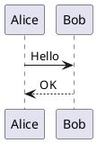

# dsh-plantuml

在 DeepSeek Harness 的 Web 和桌面会话中预览 `plantuml` 和 `puml` 代码块。回答还在生成时，已写完的图可以提前显示。生成结束后，卡片提供「图形」「代码」「编辑」三个视图。

## 安装和配置

在 DSH 中打开「插件 → 添加插件」，在「包名或地址」输入安装包或插件目录的绝对路径。然后打开「插件 → dsh-plantuml → PlantUML 渲染」，选择渲染方式并保存。配置页会自动渲染样例，显示当前渲染方式是否可用。

| 渲染方式 | 配置 |
| --- | --- |
| 自动检测本机命令 | 默认选项。检查 DSH Host 的 `PATH`。macOS 也检查 Homebrew 的标准二进制目录。 |
| 本地 JAR | 填写 DSH Host 上的 JAR 绝对路径。Host 需要能启动 Java。Windows 上的批处理启动器可用此选项替代。 |
| PlantUML 服务端 | 填写服务基础 URL，例如 `http://localhost:8080/plantuml`。插件优先请求 `/svg`，服务不提供 SVG 时尝试 `/png`。 |

远程连接时，命令、路径和 URL 都由运行 DSH 的 Host 解释。显式保存服务端模式后，用于渲染的图块源码会发送到所配置的服务。请选用受信任的服务并按部署需要启用 [PlantUML 受限配置](https://plantuml.com/security)。本地命令和 JAR 使用 `SANDBOX` 模式，外部文件和 URL 引用不可用。

三种渲染方式都优先预览 SVG，放大后依旧清晰。只输出位图的图型（如 Ditaa）仍可用 PNG 预览。

````markdown

````

## 会话图形卡片

- 回答生成中，进入可视区域的代码块在出现匹配的 `@start…` 和 `@end…` 后最多提前渲染一次。未写完的图先显示源码，语法诊断在回答结束后显示。结束时如果图和配置相同，会复用已发出的渲染请求。省略起止标记的源码在回答结束后渲染。服务端模式下，提前渲染会向已配置的服务发送图源码。

- 「图形」视图支持缩放、适应卡片和拖动超出视口的图。全屏视图还支持滚轮缩放、原始大小、适应窗口及 `Esc` 退出。触屏可用双指缩放和双击切换缩放。
- 「编辑」视图把源码和实时预览并排展示，窄卡片内上下排列。预览失败时会提示错误，并保留上一张成功的图。「恢复原文」将草稿恢复为消息中的源码。支持识别会话消息的 DSH 版本会在切换会话时保留最近的草稿，刷新页面后可通过之前导出的 `.puml` 找回。
- 会话原文首次出现语法错误时，卡片会自动打开「编辑」。如果已手动选择视图，或焦点正在图形视图的内容区，卡片会保留当前视图。点「定位到第 N 行」可选中对应源码。行号取决于渲染后端返回的位置，旧版 PlantUML 或涉及外部引用的图可能只显示错误详情。展开「错误详情」可查看和复制诊断。勾选「附上图表源码」后，诊断会一并复制源码。
- 工具栏的「导出」下拉菜单提供 SVG、PNG、去除 PlantUML 画布底色的 PNG 和 `.puml` 下载。「复制源码」和 `.puml` 导出读取当前草稿。图像导出需要当前源码渲染成功。仅输出位图的图型可下载原始 PNG。

## 渲染样式

在配置页选择 PlantUML 默认、浅色或深色主题，以及标准或手绘风格。展开「颜色与字体」，可输入背景色、文字颜色、箭头颜色（`#RRGGBB`）、字体名称和字号。留空沿用主题默认值，字体名称以渲染后端可用的字体为准。

实时预览使用已保存的渲染方式和内置时序图。保存后，样式成为会话中 PlantUML 图的默认样式，图源码可以覆盖这些默认值。Ditaa 等专用图型忽略这些设置。服务端模式下，配置页预览发送的是内置样例及所选样式。

## 开发验证

Web Client 源码在 `src/client/`。`plugin.js` 注册 DSH 插槽，`card.js` 和 `settings.js` 分别负责会话卡片和配置页。图像预览、草稿、队列、视口和导出分别由独立模块处理。

运行 `npm install` 安装开发依赖。修改 Client 源码后用 `npm run build:client` 更新发布入口 `client.js`，再执行 `npm run check`。检查会验证生成文件与源码一致，并运行 Client 加载契约、草稿、队列和 Host 渲染测试。可将 `DSH_PLANTUML_TEST_JAR` 设为本机 PlantUML JAR 的绝对路径来运行真实 JAR 测试。
