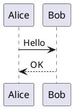

# dsh-plantuml

在 DeepSeek Harness 的 Web、桌面会话和内建侧栏 Markdown 文件预览中渲染 `plantuml` 和 `puml` 围栏。回答还在生成时，已写完的图可以提前显示。图形卡片提供「图形」「代码」「编辑」三个视图。

## 安装和配置

1. 在 DSH 中打开「插件 → 添加插件」，在「包名或地址」输入安装包或插件目录的绝对路径。
2. 打开「插件 → dsh-plantuml → PlantUML 渲染」，选择渲染方式并保存。
3. 查看配置页的自动渲染样例，确认当前渲染方式可用。

| 渲染方式 | 配置 |
| --- | --- |
| 自动检测本机命令 | 默认选项。检查 DSH Host 的 `PATH`。macOS 也检查 Homebrew 的标准二进制目录。 |
| 本地 JAR | 填写 DSH Host 上的 JAR 绝对路径。Host 需要能启动 Java。Windows 上的批处理启动器可用此选项替代。 |
| PlantUML 服务端 | 填写服务基础 URL，例如 `http://localhost:8080/plantuml`。插件优先请求 `/svg`，服务不提供 SVG 时尝试 `/png`。 |

远程连接时，由运行 DSH 的 Host 查找命令、读取文件并访问服务 URL。采用服务端渲染时，Host 在发起渲染请求时将源码发送到配置的地址。请选用受信任的服务，并按部署需要启用 [PlantUML 受限配置](https://plantuml.com/security)。本地命令和 JAR 使用 `SANDBOX` 模式，图源码应自包含，外部文件和 URL 引用不可用。

三种渲染方式都优先预览 SVG，放大后依旧清晰。只输出位图的图型（如 Ditaa）仍可用 PNG 预览。

将下面的围栏复制到会话消息，或写入要用 DSH 内建预览打开的 Markdown 文件。

````markdown

````

## 会话图形卡片

- **生成中预览**
  回答生成时，靠近可视区域的代码块在出现匹配的 `@start…` 和 `@end…` 后最多提前渲染一次。其余代码块先显示源码，回答结束后再渲染。回答结束时，源码和渲染配置均未变则复用此前的请求。语法诊断在回答结束后显示。使用服务端渲染时，提前渲染也会发送源码。

- **图形操作**
  在「图形」视图中可缩放、适应卡片或拖动超出视口的图形。全屏时可用滚轮缩放、恢复原始大小、适应窗口或按 `Esc` 退出。触屏支持双指缩放和双击切换缩放。

- **编辑草稿**
  「编辑」视图并排显示源码和实时预览，窄卡片改为上下排列。渲染失败时显示错误并保留上一张成功的图。「恢复原文」会还原消息中的源码。插件能识别会话消息时，切换会话可保留最近的草稿。需要在刷新后找回草稿时，请提前复制源码或导出 `.puml`。

- **语法诊断**
  会话原文首次出现语法错误时，卡片会自动打开「编辑」。已手动选择视图，或焦点位于图形内容区时，卡片保留当前视图。后端提供有效行号时，点击「定位到第 N 行」可选中对应源码。展开「错误详情」可查看和复制诊断。需要一并复制源码时，勾选「附上图表源码」。

- **复制与导出**
  「复制源码」和 `.puml` 导出使用当前源码，有草稿时使用草稿。当前源码渲染成功后，可按图型下载 SVG、PNG 或去除画布底色的 PNG。仅输出位图的图型可下载原始 PNG。

## 侧栏 Markdown 文件预览

使用 DSH 内建 Markdown 预览打开文件。本插件识别语言标签明确写为 `plantuml` 或 `puml` 的非空围栏。普通围栏和独立 `.puml` 文件由 DSH 原样处理。与其他代码块源码相同、无法可靠匹配的围栏保留为代码块。

- **本地渲染**
  使用本机命令或本地 JAR 时，图块靠近可视区域后自动渲染。

- **逐块发送**
  使用 PlantUML 服务端时，默认由用户点击「发送到服务端并渲染」，发送当前图块的源码。修改草稿后，再点击一次以发送修改后的源码。

- **按地址授权自动发送**
  信任当前服务时，可在「PlantUML 渲染」中勾选「允许侧栏图块自动发送到此服务」并保存。图块靠近可视区域或草稿更新时，插件会自动发送源码。更换服务地址后恢复逐块发送。要为新地址开启自动发送，重新勾选并保存。

侧栏草稿保留到切换标签或关闭预览。需要保留修改时，提前复制源码或导出 `.puml`。触屏可在侧栏内纵向滚动，在全屏视图中双指缩放。

## 渲染样式

在配置页选择 PlantUML 默认、浅色或深色主题，以及标准或手绘风格。展开「颜色与字体」，可输入背景色、文字颜色、箭头颜色（`#RRGGBB`）、字体名称和字号。留空沿用主题默认值，字体名称以渲染后端可用的字体为准。

实时预览使用已保存的渲染方式和内置时序图。保存后，样式成为会话和侧栏 Markdown 中 PlantUML 图的默认样式，图源码可以覆盖这些默认值。Ditaa 等专用图型忽略这些设置。服务端模式下，配置页预览发送的是内置样例及所选样式。
